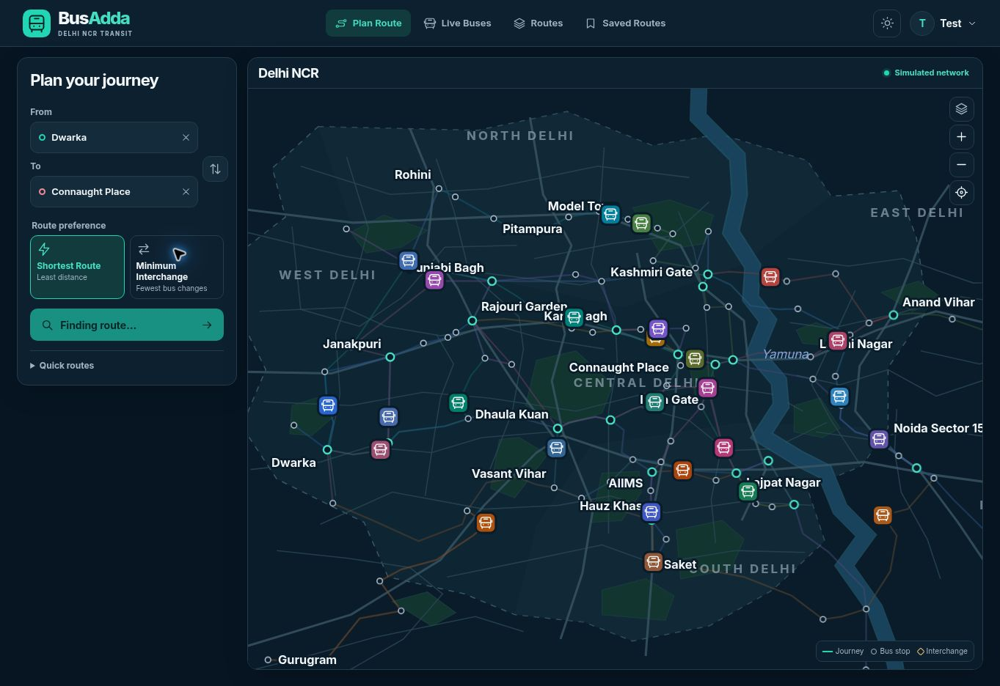
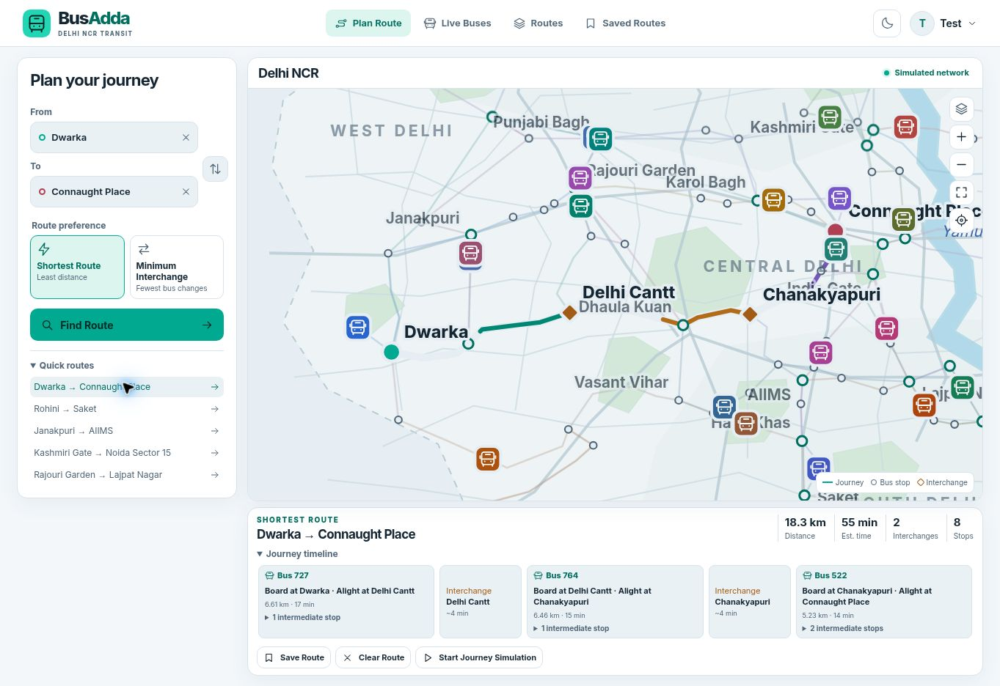

# BusAdda — A Smart Delhi NCR Bus Route Planner

**Navigate Delhi. The Smarter Way.**

BusAdda is a local full-stack Delhi NCR bus journey planner. Choose a source and destination, compare distance and transfer preferences, and follow the resulting bus legs on an interactive schematic. The network covers 102 stops and 29 bidirectional services with 29 simulated vehicles.

All stop coordinates, routes, travel times, vehicle positions and route numbers are illustrative. BusAdda uses a hand-curated demo network and has no connection to official DTC services, schedules or vehicle tracking.

## Features

- Plan trips by shortest distance or fewest interchanges across 102 demo bus stops.
- Search for a stop, landmark, or coordinate pair and find the nearest active stop by Haversine distance.
- Explore colored route lines and moving simulated buses on an interactive SVG map with pan, zoom, and layer controls.
- Follow each bus leg and interchange. Click a stop from the map or itinerary to open its details.
- Sign up or sign in with a MySQL-backed account, save trips to your profile, and switch between dark and light themes.

## Screenshots

| Dark dashboard | Light dashboard |
| --- | --- |
|  |  |

[Sign-in screen](docs/sign-in.jpg) · [Routes explorer](docs/routes.jpg)

## Storage modes

- **MySQL** is selected when a database URL is configured. It persists accounts, sessions, and saved routes, and loads the transit network from the seeded database. The SQLAlchemy models and Alembic migrations below are used in this mode.
- **In-memory demo** is the default without a database URL and uses Python dictionaries for accounts, sessions, and saved routes. The transit graph is built directly from the bundled demo data. Data is local to a single process. On Vercel, a different instance or a cold start can make an account or saved route unavailable even without a redeploy. Use throwaway credentials. For a walkthrough, describe the hosted build as an in-memory demo and MySQL as the persistent storage option.

## Run locally

Requirements are **Python 3.11+** and, for persistent storage, **MySQL 8+**. The app runs on Windows, macOS and Linux. All runtime assets, including the map and Inter typeface, are served locally. Internet access is only needed to install dependencies.

1. Clone the repository and enter its root directory.

   ```sh
   git clone https://github.com/OjasJain777/BusAdda.git
   cd BusAdda
   ```

   Create a virtual environment and copy the example configuration.

   ```powershell
   # Windows PowerShell
   py -3 -m venv .venv
   .\.venv\Scripts\Activate.ps1
   python -m pip install -r requirements.txt
   Copy-Item .env.example .env
   ```

   ```bash
   # macOS or Linux
   python3 -m venv .venv
   source .venv/bin/activate
   python -m pip install -r requirements.txt
   cp .env.example .env
   ```

2. Start your MySQL 8 server. Run the following as a MySQL administrator in MySQL Workbench or in `mysql -u root -p`. Replace the example password before executing.

   ```sql
   CREATE DATABASE busadda CHARACTER SET utf8mb4 COLLATE utf8mb4_0900_ai_ci;
   CREATE USER 'busadda'@'127.0.0.1' IDENTIFIED BY 'replace-with-your-own-password';
   GRANT ALL PRIVILEGES ON busadda.* TO 'busadda'@'127.0.0.1';
   ```

3. Generate an application secret and paste the output into `SECRET_KEY` in `.env`. Update `DATABASE_URL` with your MySQL password, percent-encoding reserved characters such as `@`, `:`, `/` and `#`.

   ```text
   python -c "import secrets; print(secrets.token_hex(32))"
   ```

   | Variable | Purpose |
   | --- | --- |
   | `SECRET_KEY` | Signs Flask sessions and CSRF tokens. |
   | `DATABASE_URL` | SQLAlchemy URL. The example uses MySQL, PyMySQL and UTF-8. |
   | `SESSION_COOKIE_SECURE` | Leave at `0` for local HTTP. Use `1` for HTTPS. |

4. Apply the schema, seed the demo network and start the app.

   ```text
   python -m flask --app run db upgrade
   python -m flask --app run seed-network
   python -m flask --app run run
   ```

   Open [http://127.0.0.1:5000](http://127.0.0.1:5000). Create an account, then sign in with the registered email and password. Sign-in is required to use the map, plan or simulate trips, explore routes, and view saved routes.

   For a production-grade local WSGI server, run `waitress-serve --listen=127.0.0.1:5000 run:app`.

### Deploy on Vercel

Import this repository into Vercel, select the **Flask** framework preset, and use the repository root. Keep the default install and build settings. `pyproject.toml` points to `run:app`, and the Vercel build stages `app/static/` under `public/static/` to keep the existing asset URLs.

### Temporary demo without a database

Deploy the demo with an empty Environment Variables section. Flask generates a temporary session key per process and uses secure cookies on Vercel. Memory mode uses the bundled network. For the same demo locally, install the dependencies and run `python -m flask --app run run` with no `.env` file.

### Persistent MySQL deployment

Provision a hosted MySQL 8 database reachable from Vercel. In the Vercel project's **Environment Variables**, set these values for Production.

| Variable | Value |
| --- | --- |
| `BUSADDA_STORAGE` | `mysql` |
| `DATABASE_URL` | The hosted database's SQLAlchemy URL using `mysql+pymysql://`. Use your provider's TLS settings and percent-encode reserved characters in the password. |
| `SECRET_KEY` | A fresh random value from `python -c "import secrets; print(secrets.token_hex(32))"`. |
| `SESSION_COOKIE_SECURE` | `1` for Vercel HTTPS. |

In your local clone, point `DATABASE_URL` at the same hosted database and set `SECRET_KEY` before initializing it. Run these commands once before the first deployment.

```text
python -m flask --app run db upgrade
python -m flask --app run seed-network
```

Deploy and open Vercel's generated URL to reach the BusAdda sign-in page. If you change the environment variables, redeploy so the new values take effect.

### Update an existing installation

Keep your existing `.env` and MySQL database. Replace the source files with this version, then run:

```text
python -m flask --app run db upgrade
python -m flask --app run seed-network
```

Restart Flask and sign in again. The migration adds a table for revocable sessions. The seed command updates service colors and adds the Greater Noida and Faridabad corridors while retaining existing stop IDs, accounts, and saved routes.

## Find a bus stop from a place

Search either field by bus stop, locality, or landmark. The bundled Delhi NCR place index has 1,892 entries, including NSUT and Lotus Temple. For a place outside the bus stop list, BusAdda ranks active network stops using Haversine distance and shows the closest match. The distance is straight-line on the simulated network. Dashed map connectors indicate the gap between the place and its bus stop. For places missing from the index, enter `latitude, longitude`.

Routes open in **Route focus**, with the selected journey highlighted above muted grey network lines. Toggle it off to show nearby buses, stops, and labels. Clear the route to restore the original network colors.

[Place-data sources and license](app/static/data/places-attribution.txt)

## Try the two routing modes

Use **Dwarka → Connaught Place** from Quick routes. The shortest journey is **18.3 km** with two transfers. Minimum Interchange uses direct bus **817** in a **25.28 km** journey. Choose a mode and click **Find Route** to compare the map and itinerary.

Drag to pan. Scroll, use the zoom buttons, or pinch on touchscreens to explore Greater Noida, Faridabad and the surrounding NCR. The **Routes** tab supports selecting multiple services, showing or hiding lines, and exploring their ordered stops. Click a bus for the simulated ETA and a shortcut to highlight its corridor. The map layers menu controls route lines, stops, vehicles, and locality labels. Journey highlights remain visible when network lines are hidden. **Start Journey Simulation** plays an accelerated preview of the planned trip.

## Tech stack and architecture

| Path | Responsibility |
| --- | --- |
| `app/algorithms/` | Directed transit graph, Haversine, Bidirectional Dijkstra and 0–1 BFS. |
| `app/network.py` | Loads a database snapshot, builds adjacency and prepares local map data. |
| `app/journey.py` | Groups ride edges into bus legs and computes estimated travel time. |
| `app/auth.py`, `app/views.py` | Session-based auth, page routes and JSON endpoints. |
| `app/templates/`, `app/static/` | Jinja HTML, CSS themes and vanilla JavaScript SVG UI. |
| `scripts/network_data.py` | Reproducible stop coordinates and hand-curated corridors. |
| `migrations/`, `tests/` | Alembic migrations and routing, database and browser checks. |

The stack is Flask, Flask-SQLAlchemy, Flask-Migrate, Flask-Login, Flask-WTF, Werkzeug, MySQL and vanilla HTML, CSS, JavaScript, and SVG. JSON endpoints serve the network, calculate journeys and manage saved routes. Each process builds and reuses one read-only network snapshot. Restart the application after changing seed data or services.

### Routing

- **Distance.** Consecutive ordered stops form directed edges. Each edge keeps the bus service and direction, and its weight is Haversine distance using a 6,371 km radius. Bidirectional Dijkstra expands from the origin and destination using outgoing and reverse adjacency. It stops once the two smallest unsettled distances cannot improve the best complete journey. Stored edges preserve the service for each reconstructed leg.
- **Interchanges.** Each state combines stop, service and direction. Riding costs zero and switching to an eligible departure at a shared stop costs one. All eligible first rides enter the deque at cost zero. After 0–1 BFS computes the transfer cost for each state, a distance-only pass searches the edges that preserve those costs. It selects the shortest route among the minimum-transfer journeys. A direction change on the same numbered service counts as changing buses.
- **Time and animation.** Journey estimates use each service’s demo speed, 14-second intermediate dwells and four minutes per interchange. They exclude first-bus waiting and traffic. Vehicles follow the same illustrative corridor geometry as the SVG paths, dwell at stops and reverse at termini. The simulation runs at 4× speed and displays simulated ETAs in network time. Routing weights still use Haversine distance between stops. The browser derives their positions from the server clock and seeded offsets. No frame-by-frame API request or database write is needed.

### Database

| Table | Relationships and constraints |
| --- | --- |
| `users` | Unique normalized email and Werkzeug scrypt password hash. |
| `auth_sessions` | Hashed session token, user foreign key and expiry. Logout removes the corresponding row. |
| `bus_stops` | Unique name, locality and schematic geographic coordinates. |
| `bus_services` | Unique demo number, region, color and speed. |
| `service_stops` | Ordered stop and direction per service, indexed by stop and service sequence. |
| `saved_routes` | User and two stop foreign keys. One row per user, stop pair and routing mode. |
| `simulation_vehicles` | Seeded start time, progress, direction and speed. Indexed by service. |

A signed HTTP-only cookie carries the session token. Flask validates it against the configured store. Writes use CSRF protection, and saved-route queries are scoped to the signed-in user. Seeding is transactional and repeatable on a migrated database.

## Tests

```text
python -m pip install -r requirements-dev.txt
python -m pytest -q
```

The default backend suite uses a temporary SQLite database with foreign keys enabled. To test MySQL, create an empty MySQL database named `busadda_test`, grant the test user access to it, and set `BUSADDA_TEST_DATABASE_URL` to its SQLAlchemy URL before running pytest. The tests migrate and seed this dedicated database and add synthetic test accounts.

To include Chromium UI tests, run `python -m playwright install chromium`, set `BUSADDA_BROWSER_TESTS=1`, then rerun pytest. Set `BUSADDA_CHROMIUM` to use an installed Chromium executable and `BUSADDA_SCREENSHOTS` to write fresh screenshots. On PowerShell, set these variables with `$env:VARIABLE = "value"`.

## Demo limitations

The map simplifies street geometry and travel distance is the sum of great-circle stop-to-stop distances. Routing assumes every demo service is available in both directions and has no timetable, fares, walking links or traffic. The app is designed for local use. Public deployment would require deployment-specific safeguards such as HTTPS and rate limiting.

Inter is redistributed under the SIL Open Font License. See [the bundled license](app/static/fonts/OFL.txt).
